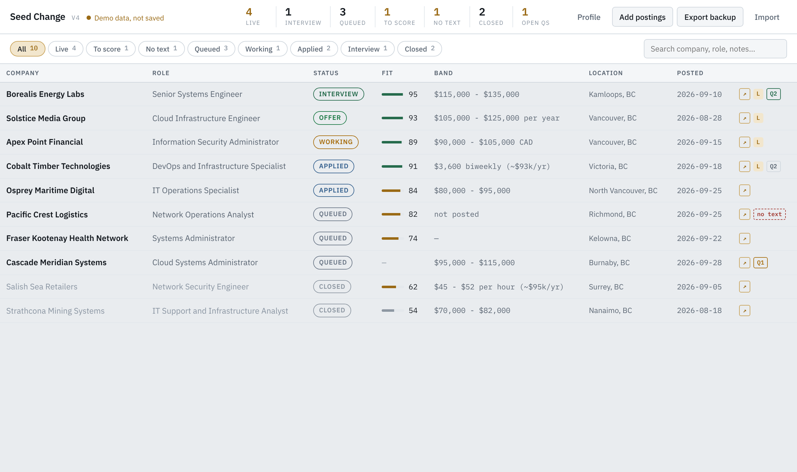
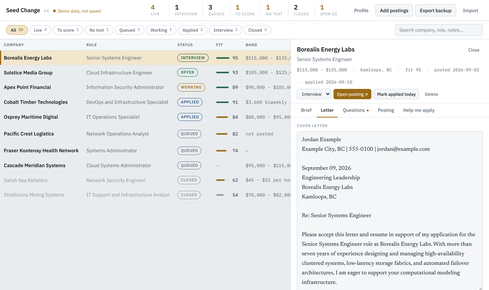
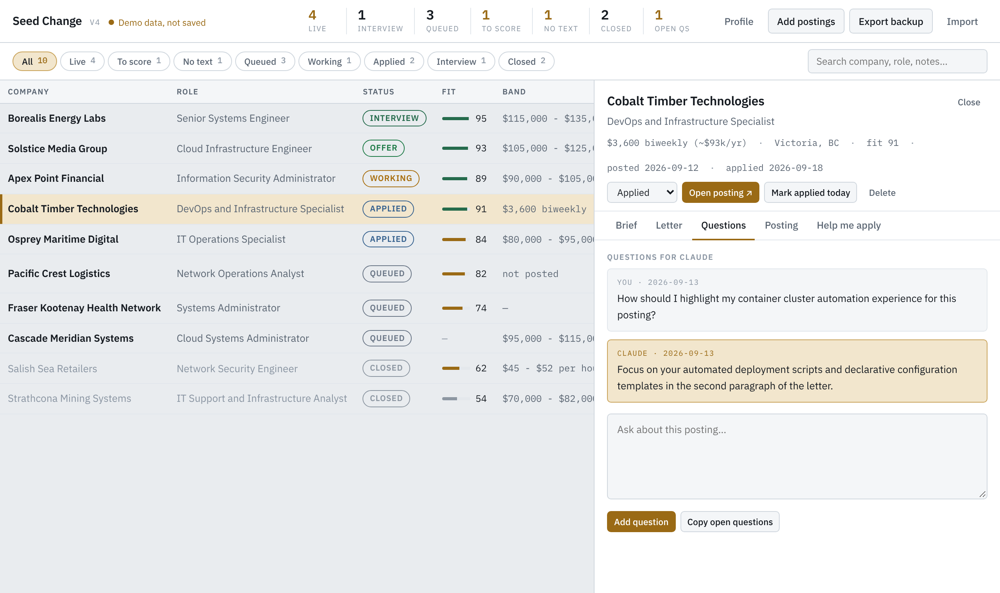
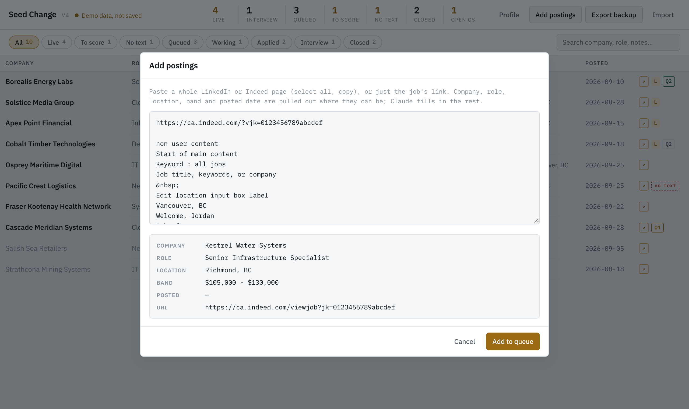
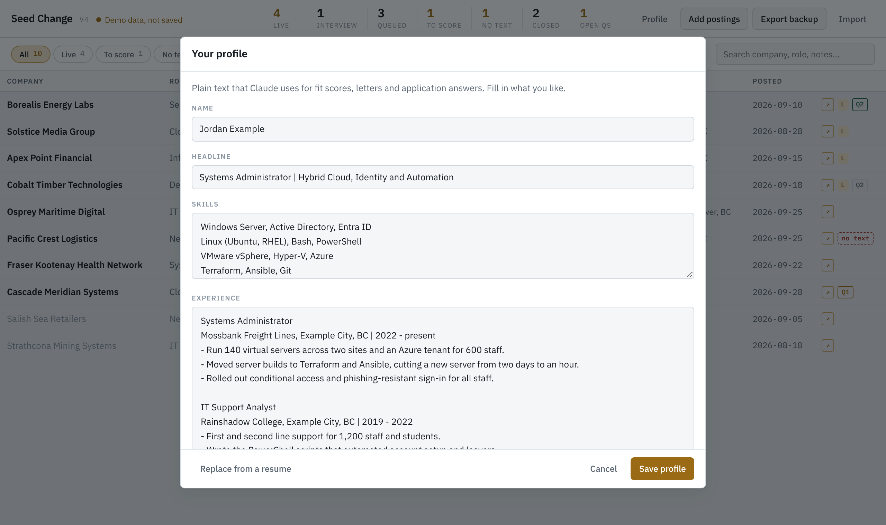
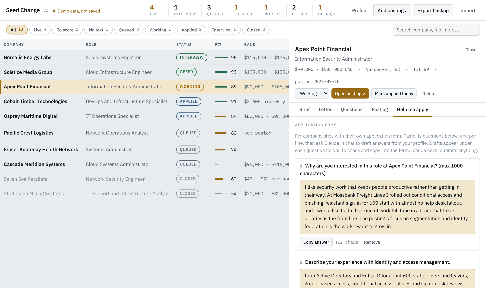

# Seed Change

A job application tracker in a single HTML page, built to work alongside an AI
assistant. It used to be called Application Desk; the repository keeps that
name. You collect postings and make the decisions; Claude reads the same
queue, scores the fit, drafts cover letters and answers your questions, and the
page updates live.



## What it does

- **Paste a posting, get a row.** Paste a whole LinkedIn or Indeed page (select
  all, copy), or just the job's link. Company, role, location, pay band and
  posted date are pulled out. On an Indeed search page, only the job you
  selected is kept, not the list around it. Duplicates are caught by link, by
  job id, or by the same company and title on either site.
- **Track the pipeline.** Queued, working, applied, interview, offer, closed,
  with a fit score, notes, and filters for what still needs a score or is
  missing its posting text.
- **Write the letter.** Each job has a cover letter you can edit in place,
  clean of em dashes in one click, and save as a PDF that fits on one page.
- **Ask about a job.** Each job has a question thread. Add a question, mention
  it in chat, and the answer shows up in the thread.
- **Start from your resume (optional).** **Get started** reads a resume you
  paste, or a PDF or Word file you pick, into a profile: name, headline, skills
  and experience, which you check before saving. Claude uses it for fit scores,
  letters and application answers. It opens by itself once when there is no
  profile yet, and every step can be skipped.
- **Help me apply.** For company sites with their own long application form,
  paste its questions into the job's Help me apply tab. Ask Claude in chat and
  it drafts an answer to each one from your profile, for you to check and copy
  into the form. It never submits anything.

<p>
  
  
  
</p>
<p>
  
  
</p>

## How it works

The page is published as a [Claude](https://claude.ai) artifact with two
capabilities: a shared database (`db`) and file downloads (`downloads`). Jobs
live in the database, one document per job, next to one profile document,
and the page subscribes to them.
Claude, signed in as the same person, reads and writes those documents with its
artifact tools, so a fit score or an answer it writes appears in the open page
without a reload.

All data access goes through one small store interface in the page. The
artifact database is one store; a demo store with fictional jobs is another; a
hosted backend later would be a third. See [docs/schema.md](docs/schema.md) for
the data model.

## Try the demo

Outside claude.ai the page runs as a demo with fictional jobs, and nothing is
saved. Serve the `public` folder and open it:

```
npx serve public
```

or `python -m http.server 4310 --directory public`. Opening `index.html`
straight from disk won't work, because browsers block it from reading the
sample data.

## Run your own

New to all this? [docs/SETUP.md](docs/SETUP.md) walks through it step by step,
no GitHub or coding needed.

Ask Claude to publish `public/index.html` as an artifact with the `db` and
`downloads` capabilities (where your plan offers artifact databases). Open it,
paste a few postings, then ask Claude in chat to score them or draft a letter,
pointing it at [docs/schema.md](docs/schema.md) for the fields. Use **Export
backup** now and then; [scripts/pack-backup.js](scripts/pack-backup.js) turns a
listing of the database into the same export format if you want scheduled
backups.

## Development

- No build step. The app is `public/index.html`; the tests read the parsers
  straight out of it.
- Run the tests with `node --test` (Node 18 or later, nothing to install). Any
  change to the paste parser, the resume reader or the form question splitter
  needs a fixture in `tests/fixtures/`, and fixtures are always invented, never
  a real posting, resume or form.
- Read [AGENTS.md](AGENTS.md) before contributing. It covers the privacy rules,
  the pre-commit hook and the deploy checklist, for people and AI agents alike.
- [docs/roadmap.md](docs/roadmap.md) has what's done, what's next and the
  deploy log.

## License

[MIT](LICENSE)
